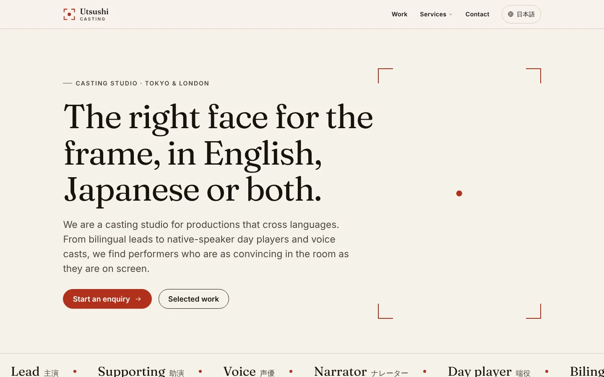
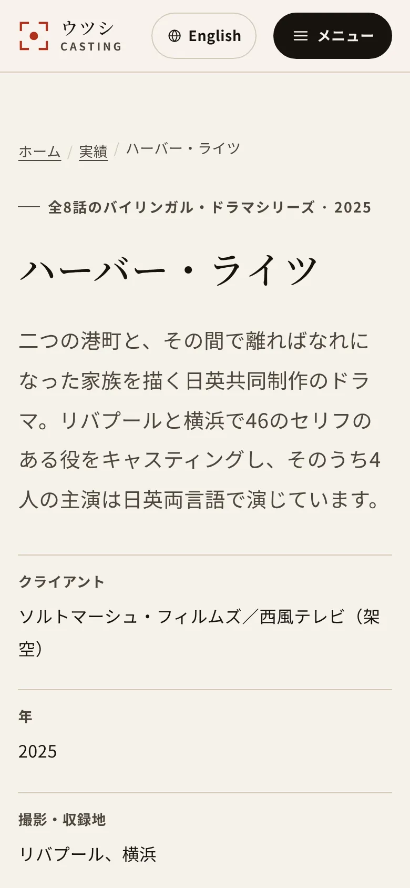
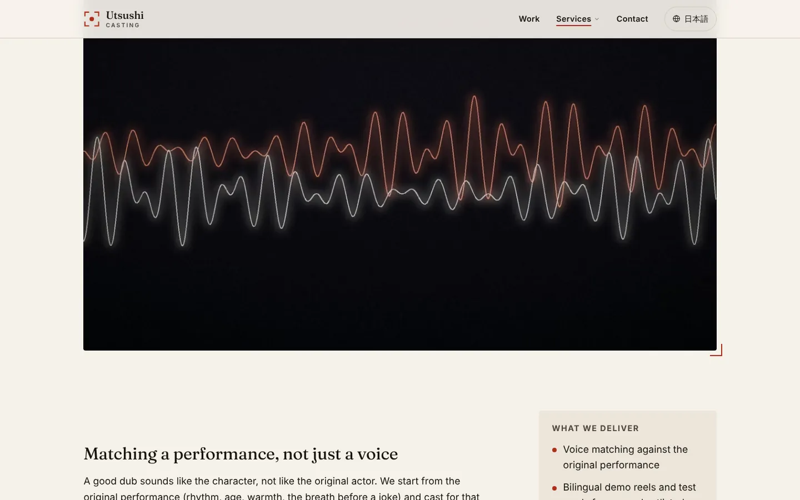
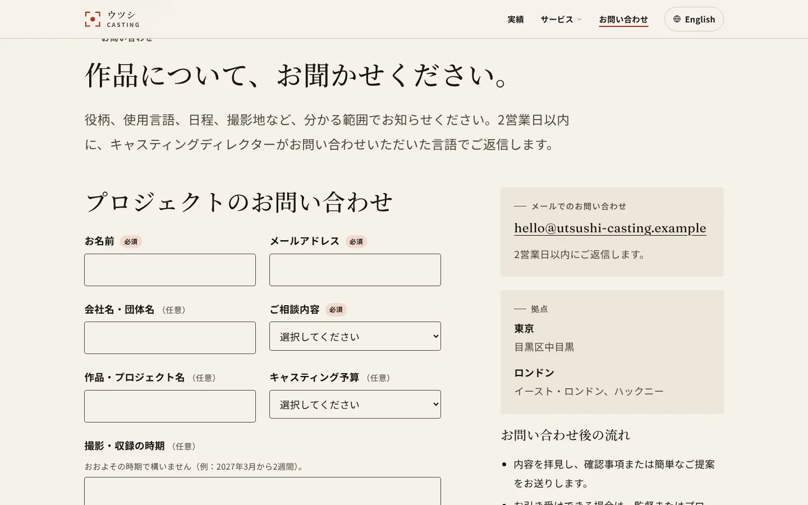

# Utsushi Casting

[](https://github.com/MilanG-Ne/utsushi-casting/actions/workflows/ci.yml)

A bilingual (English / Japanese) studio website for **Utsushi Casting**, a fictional casting
agency with studios in Tokyo and London. It is a portfolio demonstration of a
production-grade marketing site: field-level localized CMS content, international SEO, a
strict performance budget checked in CI, WCAG 2.2 AA accessibility work, and a contact
pipeline that does not lose an enquiry when the CRM is down.

**Stack:** Next.js 16 (App Router, TypeScript, Server Components) · Sanity Studio 6 with
field-level localization · Vercel · GSAP (homepage only) · Zod · Playwright + axe ·
Lighthouse CI · Plausible.



| Japanese case study, phone | Service page | Japanese contact form |
| --- | --- | --- |
|  |  |  |

## Contents

- [What it does](#what-it-does)
- [Local setup](#local-setup)
- [Deployment (Vercel)](#deployment-vercel)
- [CMS content model](#cms-content-model)
- [i18n approach](#i18n-approach)
- [SEO](#seo)
- [Performance budget and results](#performance-budget-and-results)
- [Accessibility](#accessibility)
- [Contact pipeline](#contact-pipeline)
- [Analytics](#analytics)
- [CI](#ci)
- [Project structure](#project-structure)
- [Notes and limitations](#notes-and-limitations)

## What it does

- **Two complete languages.** English at the root, a full Japanese mirror under `/ja`.
  Eight pages per language: home, work index, two case studies, three service pages and
  contact, plus a designed, server-rendered 404.
- **Language switch that keeps your place.** `/work/harbour-lights` ⇄
  `/ja/work/harbour-lights`, rendered on the server with no client JavaScript.
- **International SEO.** Per-page titles and descriptions in both languages, self-referencing
  canonicals, `hreflang` for `en`, `ja` and `x-default` on every page, a bilingual sitemap with
  alternates, robots rules, Open Graph cards per page and language, and JSON-LD for
  Organization, WebSite, WebPage, Service, BreadcrumbList and VideoObject.
- **Sanity CMS** with field-level localization (`{ en, ja }` on every translatable field),
  four document types, an embedded Studio at `/studio`, bilingual seed content, a seed
  script and webhook-driven revalidation.
- **Fast by construction.** First-load JS 135–137 KB gzipped on every page (budget 150 KB,
  checked in CI), Lighthouse mobile 92–99, LCP 1.9–2.3 s, CLS 0. GSAP is loaded only on the
  homepage, lazily, and never under `prefers-reduced-motion`. Video sits behind a
  click-to-load facade.
- **Accessible.** Skip link, landmarks, visible focus, keyboard-operable navigation built on
  the native Popover API, reduced-motion support, a pause control for the moving marquee,
  localized form errors with an error summary, and `lang` attributes wherever languages mix.
  axe (WCAG 2.2 AA rules) runs against every page in both languages in CI.
- **A contact form that does not lose enquiries.** Works without JavaScript, validates on
  the server, posts a signed, versioned JSON payload to a (mock) CRM, falls back to email
  and retries from a durable outbox with exponential backoff.

## Local setup

Requirements: Node.js 22.12+ and pnpm 10 (`corepack enable` picks up the version pinned in
`package.json`).

```bash
pnpm install
pnpm dev            # http://localhost:3000 and http://localhost:3000/ja
```

No accounts or keys are needed. Without a Sanity project ID the site reads the bundled
seed content in `content/seed`, through the same mapping code the CMS uses.

| Script | What it does |
| --- | --- |
| `pnpm dev` / `pnpm build` / `pnpm start` | Next.js development, production build, production server |
| `pnpm lint` / `pnpm typecheck` | ESLint (Next.js core-web-vitals, jsx-a11y, TypeScript rules) and `tsc` |
| `pnpm test` | Unit tests (Vitest): routing, hreflang, metadata, JSON-LD, content mapping, enquiry pipeline |
| `pnpm test:e2e` | Playwright against the production build: routing, SEO, axe, keyboard, video, GSAP scope, CLS, contact form |
| `pnpm budget` | First-load JS budget check (run after `pnpm build`) |
| `pnpm lhci` | Lighthouse CI, mobile, five runs per URL (run after `pnpm build`) |
| `pnpm seed` | Seed a Sanity dataset with the bilingual content (`--dry-run` prints the documents) |
| `pnpm schema:enquiry` | Regenerate `docs/enquiry-payload.schema.json` from the Zod schema |
| `pnpm media` | Regenerate the procedural images and videos (Python, Pillow, ffmpeg) |

Environment variables are documented in [`.env.example`](.env.example). Copy it to
`.env.local` for anything beyond the defaults. To try the CRM outage path locally, see
[Trying the outage path locally](docs/enquiry-payload.md#trying-the-outage-path-locally).

## Deployment (Vercel)

1. Push the repository to GitHub and import it in Vercel. The framework preset (Next.js),
   build command and output are detected automatically.
2. Deploy. With no environment variables the site builds from the bundled seed content and
   the contact form talks to the built-in mock CRM. Canonical URLs use the project's
   production domain automatically (`VERCEL_PROJECT_PRODUCTION_URL`); set
   `NEXT_PUBLIC_SITE_URL` if you add a custom domain.
3. Optional services, all of which have free tiers:

   | Service | How | Environment variables |
   | --- | --- | --- |
   | Sanity | See [Connecting Sanity](#connecting-sanity) | `NEXT_PUBLIC_SANITY_PROJECT_ID`, `NEXT_PUBLIC_SANITY_DATASET`, `SANITY_REVALIDATE_SECRET` |
   | Durable enquiry outbox | Vercel Marketplace → Upstash Redis, connect to the project | Added by the integration; `KV_REST_API_URL`/`KV_REST_API_TOKEN` and `UPSTASH_REDIS_REST_URL`/`UPSTASH_REDIS_REST_TOKEN` are both supported |
   | Email fallback | Create a Resend API key | `RESEND_API_KEY`, `ENQUIRY_EMAIL_TO`, `ENQUIRY_EMAIL_FROM` |
   | Retry schedule | Set a random secret | `CRON_SECRET` |
   | Request signing | Shared secret with the CRM | `CRM_SIGNING_SECRET` |
   | Analytics | Add the site in Plausible | `NEXT_PUBLIC_PLAUSIBLE_SCRIPT_URL` |

4. `vercel.json` registers a daily Vercel Cron job that drains the enquiry outbox (the
   Hobby plan allows one run per day). For a 15-minute cadence on Hobby, set the
   `ENQUIRY_RETRY_URL` repository variable and the `CRON_SECRET` repository secret and the
   **Retry queued enquiries** GitHub workflow takes over.

### Connecting Sanity

1. Create a free project at [sanity.io/manage](https://www.sanity.io/manage) with a public
   `production` dataset.
2. Under **API → CORS origins**, add your site URL (and `http://localhost:3000`) with
   credentials allowed, so the embedded Studio at `/studio` can sign in.
3. Seed the content, either locally:

   ```bash
   NEXT_PUBLIC_SANITY_PROJECT_ID=<id> SANITY_API_WRITE_TOKEN=<editor token> pnpm seed
   ```

   or from GitHub: add the `NEXT_PUBLIC_SANITY_PROJECT_ID` repository variable and the
   `SANITY_API_WRITE_TOKEN` repository secret, then run the **Seed Sanity** workflow.
   The script is idempotent (fixed document IDs, deduplicated image uploads).
4. Add `NEXT_PUBLIC_SANITY_PROJECT_ID` (and `NEXT_PUBLIC_SANITY_DATASET`) in Vercel and
   redeploy. The build now reads from Sanity and fails loudly if the dataset is empty or
   the content doesn't match the expected shape.
5. Under **API → Webhooks**, add `https://<site>/api/revalidate` (on create, update and
   delete, projection `{_type, "slug": slug.current}`) with `SANITY_REVALIDATE_SECRET`.
   Edits go live without a rebuild. New case studies or services need a deploy, because
   unknown slugs are served by the static 404; a second Sanity webhook that calls a Vercel
   deploy hook (filtered to `create`) handles that.

## CMS content model

Every translatable field is a localized object, so one document holds both languages and
shares its slug, references, images and dates. English is required; a missing Japanese value
is a warning, and Studio list previews show the translation status (`EN ✓ · JA ✓`).

| Localized type | Shape |
| --- | --- |
| `localeString` | `{ en: string, ja: string }`, shown side by side |
| `localeText` | `{ en: text, ja: text }` |
| `localePortableText` | `{ en: blockContent, ja: blockContent }` (headings, lists, quotes, links) |

| Document | Purpose | Main fields |
| --- | --- | --- |
| `siteSettings` (singleton) | Organization data | name, tagline, description, email, founding year, studios (city, area, schema.org locality and country) |
| `page` (`home`, `work`, `contact`) | Fixed pages | navigation title, eyebrow, heading, intro, body, SEO; home only: figures, featured case studies, showreel, casting process |
| `caseStudy` | `/work/<slug>` | title, slug, summary, body, client, year, format, locations, roles cast, outcomes, credits, services, hero image, video, order, SEO |
| `service` | `/services/<slug>` | title, slug, short summary, summary, hero image, body, deliverables, process steps, questions, order, SEO |

Shared objects: `localizedImage` (image with hotspot and localized alt text), `video` (title,
description, file URL, poster, duration, upload date, audio flag), `seo`, `stat`, `step`,
`faqItem`, `credit`, `studioLocation`.

One GROQ query (`lib/content/queries.ts`) returns the whole site. The result is validated with
Zod (`lib/content/schema.ts`) and mapped to per-language view models
(`lib/content/index.ts`). The fixture source builds the same bundle from the seed documents,
so local development, CI and Lighthouse exercise the same code path as production.

## i18n approach

The full routing plan, written before any code, is in
[`docs/architecture.md`](docs/architecture.md). In short:

- **Two real route trees.** `app/en` and `app/ja` each have their own root layout, so
  `<html lang>` is correct in the server HTML. Route files are three-line bindings to
  shared views in `views/`, and a unit test checks the two trees stay identical.
- **English at the root without middleware.** Config rewrites in `next.config.ts` map
  `/work` → `app/en/work`; `/en/...` permanently redirects to the root so English never has
  two URLs. Pages stay fully static and no function runs for a page view.
- **One route registry** (`lib/i18n/routes.ts`) produces every URL. The language switch,
  `hreflang` tags and sitemap alternates all come from the same `alternates(route)` call,
  so they cannot drift apart.
- **UI strings** live in typed dictionaries (`lib/i18n/dictionaries`); the Japanese one is
  typed against the English one, so a missing key fails the build. CMS copy falls back to
  English when a translation is missing, and the fallback text gets `lang="en"`.
- **Japanese typography:** system Gothic/Mincho stacks (no multi-megabyte CJK web font),
  `line-break: strict`, `word-break: auto-phrase` for headings, and adjusted line heights.
- **404s:** unknown URLs get a server-rendered bilingual page with a real 404 status
  (`app/global-not-found.tsx`); on `/ja/...` URLs the Japanese copy comes first.

## SEO

| Feature | Where |
| --- | --- |
| Titles, descriptions, canonical, `hreflang` (`en`, `ja`, `x-default`), Open Graph, Twitter cards | `lib/seo/metadata.ts` |
| JSON-LD `@graph`: Organization, WebSite, WebPage (CollectionPage, ContactPage), BreadcrumbList, Service, VideoObject | `lib/seo/jsonld.ts`, `lib/seo/structured-data.ts` |
| Sitemap for both languages with `xhtml:link` alternates | `app/sitemap.ts` |
| robots.txt (blocks `/api` and `/studio`; blocks everything on preview deployments) | `app/robots.ts` |
| Open Graph cards per page and language (1200×630) | `scripts/media/og.py` → `public/media/og` |

## Performance budget and results

Full methodology and per-page numbers: [`docs/performance.md`](docs/performance.md).

| Budget | Target | Result |
| --- | --- | --- |
| First-load JS per page (gzip) | < 150 KB, enforced in CI | 134.8–136.8 KB on all 16 pages |
| Lighthouse performance (mobile, median of 5) | ≥ 90 | 92–99 |
| Largest Contentful Paint (lab) | < 2.5 s | 1.89–2.33 s |
| Cumulative Layout Shift | 0 | 0 on every page (Lighthouse and Playwright) |
| Lighthouse accessibility / best practices / SEO | — | 100 / 100 / 100 |
| GSAP + ScrollTrigger | Homepage only, lazy | 43.7 KB, loaded after hydration, never on other routes |

About 133 KB of each page is the Next.js 16 / React 19 runtime. The site's own client code
adds 1–4 KB: the video facade, the enquiry form and the homepage motion controller are the
only client components.

## Accessibility

Built for WCAG 2.2 AA:

- Skip link, landmarks with labels, one `h1` per page, breadcrumbs with `aria-current`.
- High-contrast focus outlines on every interactive element; `scroll-padding` keeps focused
  elements clear of the sticky header (2.4.11), and open menus close when focus leaves them.
- Navigation menus use the native Popover API: Esc and light dismiss without JavaScript,
  focus returns to the trigger.
- `prefers-reduced-motion` turns off transitions and smooth scrolling, and GSAP is not
  loaded at all. The continuously moving marquee has a visible pause button (2.2.2).
- Interactive targets meet the 24 px minimum (2.5.8) and primary controls are 44 px high;
  pages reflow at 320 px without horizontal scrolling.
- Forms: visible labels, required markers, help text linked with `aria-describedby`,
  `aria-invalid`, an error summary that receives focus and links to each field, and status
  messages announced in place. The form works without JavaScript.
- Mixed-language content is marked with `lang` (the language switch, the bilingual 404, any
  untranslated CMS fallback). Videos have no audio and a visible text description.

Automated coverage in CI: axe with the `wcag2a`, `wcag2aa`, `wcag21a`, `wcag21aa` and
`wcag22aa` rule sets on all 16 pages and both 404 variants, plus phone-width runs with the
menu open, and Playwright keyboard tests (skip link, menu, focus visibility). Automated tests
catch a subset of WCAG issues; they are not a substitute for a manual audit with assistive
technology.

## Contact pipeline

`POST /api/enquiries` → validate (Zod) → build an immutable v1 payload (UUIDv7 ID) → write it
to the outbox → POST to the CRM with an `Idempotency-Key` and an HMAC signature → on failure,
email the team and retry with backoff (1 min → 24 h), then dead-letter with a manual-entry
email. The visitor only sees success when the enquiry is held somewhere durable; otherwise
they get the studio's email address.

The payload contract, response handling, configuration and a local outage walkthrough are in
[`docs/enquiry-payload.md`](docs/enquiry-payload.md), with a generated JSON Schema in
[`docs/enquiry-payload.schema.json`](docs/enquiry-payload.schema.json).

## Analytics

[Plausible](https://plausible.io) runs only when `NEXT_PUBLIC_PLAUSIBLE_SCRIPT_URL` is set. It
is cookieless and collects no personal data, so there is no consent banner. Successful
enquiries send an `Enquiry` custom event with the page language and delivery result.

## CI

| Workflow | Runs |
| --- | --- |
| `ci.yml` | On every push and pull request: lint, typecheck, unit tests; build, JS budget, Playwright (routing, SEO, axe, keyboard, video, GSAP scope, CLS, contact pipeline with a simulated CRM outage); Lighthouse CI with mobile assertions |
| `seed-sanity.yml` | Manually: seeds a Sanity dataset |
| `retry-enquiries.yml` | Every 15 minutes, once configured: drains the enquiry outbox |

## Project structure

```text
app/en, app/ja         Locale route trees (root layout, pages, not-found)
app/api                Enquiries, retry drain, mock CRM, Sanity revalidation webhook
app/studio             Embedded Sanity Studio
app/global-not-found   Bilingual server-rendered 404
views/                 Page implementations shared by both locales
components/            UI components (server by default; three client components)
lib/i18n               Locale config, route registry, dictionaries
lib/content            GROQ query, Zod schema, Sanity and fixture sources, mappers
lib/seo                Metadata, JSON-LD
lib/enquiries          Payload schema, pipeline, CRM client, email, outbox, signing
sanity/                Schemas (localized types, documents), desk structure
content/seed           Bilingual seed documents and media manifest
scripts/               Seed, JS budget, payload schema, media and OG generators
tests/unit, tests/e2e  Vitest and Playwright suites
docs/                  Architecture, enquiry payload, performance
```

## Notes and limitations

- Utsushi Casting, its people, clients, productions and figures are fictional. All imagery
  and video is procedurally generated by the scripts in `scripts/media`.
- The rate limit on the enquiry endpoint is per serverless instance (best effort). Use the
  hosting platform's firewall for real abuse protection.
- `next start` logs an internal `NoFallbackError` when an unknown slug is requested. The
  response is still a correct, server-rendered 404; the log comes from the experimental
  `globalNotFound` handling in Next.js 16.
- Lighthouse runs in CI against a local production server; see
  [Reading these numbers](docs/performance.md#reading-these-numbers).

## License

MIT for the code — see [LICENSE](LICENSE). Third-party fonts and libraries are listed in
[THIRD_PARTY_NOTICES.md](THIRD_PARTY_NOTICES.md).
